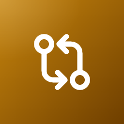
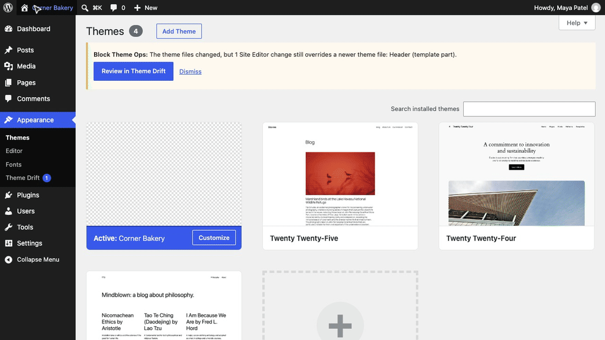
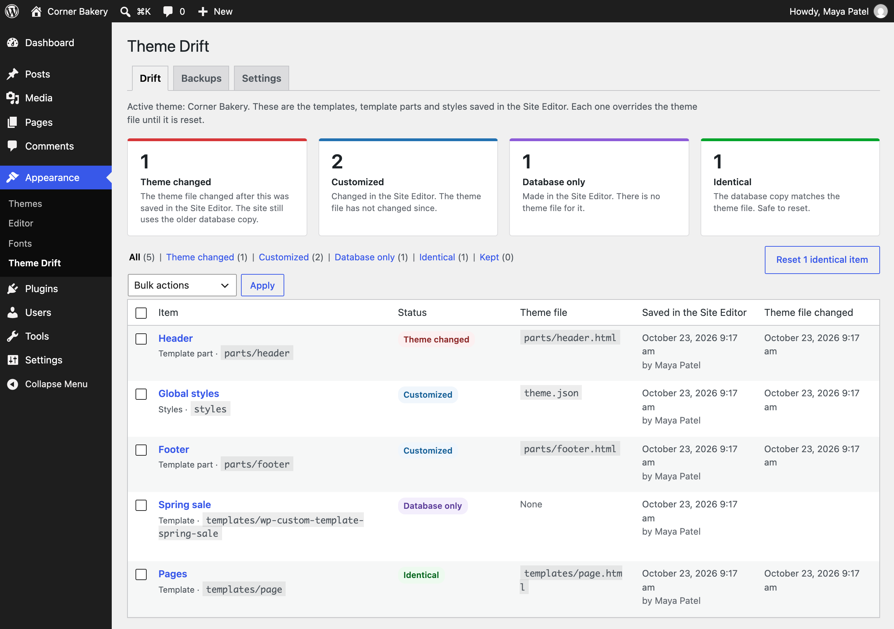
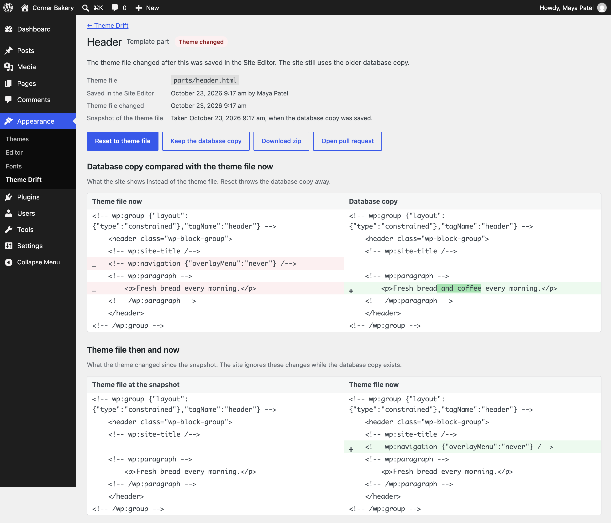
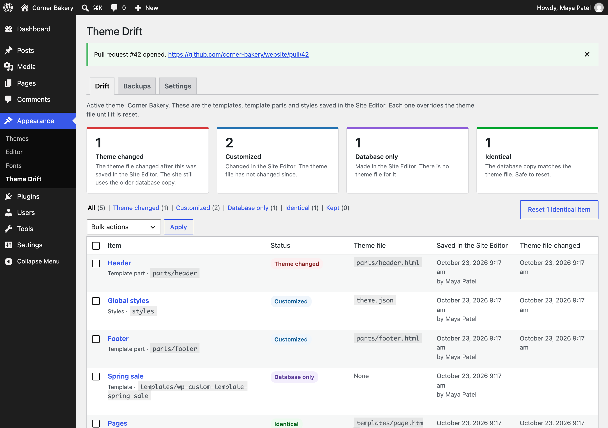
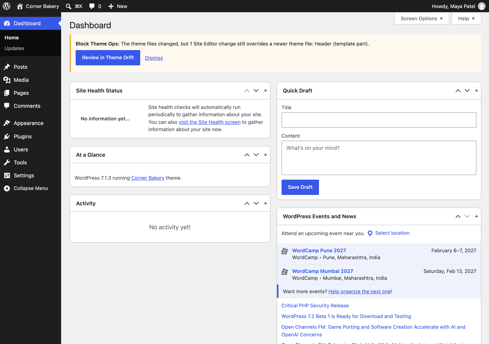

<p align="center"></p>

<h1 align="center">Block Theme Ops</h1>

<p align="center">
  <a href="https://playground.wordpress.net/?blueprint-url=https://raw.githubusercontent.com/aryanjasala/block-theme-ops/main/blueprint.json"></a>
  <a href="https://github.com/aryanjasala/block-theme-ops/releases/latest"></a>
  
  
  <a href="LICENSE.md"></a>
  <br>
  <a href="https://github.com/aryanjasala/block-theme-ops/actions/workflows/phpcs.yml"></a>
  <a href="https://github.com/aryanjasala/block-theme-ops/actions/workflows/phpstan.yml"></a>
  <a href="https://github.com/aryanjasala/block-theme-ops/actions/workflows/unit-tests.yml"></a>
  <a href="https://github.com/aryanjasala/block-theme-ops/actions/workflows/e2e-tests.yml"></a>
  <a href="https://github.com/aryanjasala/block-theme-ops/actions/workflows/plugin-check.yml"></a>
</p>

<p align="center">Find the Site Editor changes that override your theme files, see what a theme deploy left behind, then reset them or send them to Git.</p>

<p align="center">
  
</p>

---

When someone edits a template, template part or the global styles in the Site Editor, WordPress saves a copy in the database and the site ignores the theme file from then on. Deploy a new version of the theme and nothing tells you the site still shows the old one. Block Theme Ops lists every one of those copies, tells you which ones now hide a newer theme file, and resets them or sends them to the theme's Git repository.

> [!NOTE]
> Free and open source under the GPL. No pro version, no upsells, no ads in wp-admin, no tracking. And it stays that way.

## Features

- **Every Site Editor change** of the active theme (and its parent): templates, template parts and global styles, with the theme file, who saved it and when
- **Drift status**: theme changed (the file changed after the edit, so the site ignores it), customized, database only, identical
- **Three-way view**: the theme file at the time of the edit, the theme file now and the database copy, as diffs
- **Reset to theme file** with a backup, and **Undo** for 30 days. **Keep** hides an item until its file changes again. Identical copies reset in bulk
- **After a theme update**, and once a day for Git or SFTP deploys: an admin notice, a Site Health check and an optional email
- **Export** a zip laid out like the theme, or open a **GitHub pull request** with the changes as one commit
- **WP-CLI** for every action, with `wp block-theme-ops check` exiting 1 for CI and deploy scripts, and **abilities** for AI agents on WordPress 6.9+

## Install

1. Download `block-theme-ops.zip` from the [latest release](https://github.com/aryanjasala/block-theme-ops/releases/latest).
2. In WordPress, go to **Plugins > Add New Plugin > Upload Plugin**, choose the zip and activate it.

Or with WP-CLI:

```sh
wp plugin install https://github.com/aryanjasala/block-theme-ops/releases/latest/download/block-theme-ops.zip --activate
```

Needs WordPress 6.6+ and PHP 7.4+. To try it first, the **Try in WordPress Playground** badge opens a throwaway WordPress in your browser with the plugin and some demo content.

## Quick look

Stop a deploy, or fail CI, when Site Editor changes hide the new theme files:

```sh
wp block-theme-ops check || wp block-theme-ops status --status=theme-changed
wp block-theme-ops diff parts/header --against=theme
wp block-theme-ops export --pr
```

Put the GitHub token in wp-config.php, not the database:

```php
define( 'BLOCK_THEME_OPS_GITHUB_TOKEN', 'github_pat_...' );
```

## Screenshots

<table>
  <tr>
    <td width="50%" valign="top"> Theme Drift: counts per status and every Site Editor change of the active theme"><br><sub>Appearance > Theme Drift: counts per status and every Site Editor change of the active theme</sub></td>
    <td width="50%" valign="top"><br><sub>One template part: the database copy against the theme file now, and what the theme changed since the edit</sub></td>
  </tr>
  <tr>
    <td width="50%" valign="top"><br><sub>A pull request opened on GitHub with the selected Site Editor changes</sub></td>
    <td width="50%" valign="top"><br><sub>The notice after a theme update leaves a Site Editor change behind</sub></td>
  </tr>
</table>

## Documentation

| Doc | What it covers |
| --- | --- |
| [Reference](docs/REFERENCE.md) | How drift is detected, reset and undo, export, hooks, abilities, WP-CLI and stored data |
| [Development](docs/DEVELOPMENT.md) | Local setup, commands and tests |
| [Contributing](docs/CONTRIBUTING.md) | Pull requests, required checks and PR titles |
| [Releasing](docs/RELEASING.md) | How merged pull requests become releases |
| [Security](docs/SECURITY.md) | Reporting a vulnerability |
| [readme.txt](readme.txt) | What WordPress.org shows, with the FAQ and changelog |

## Project structure

```
block-theme-ops.php        plugin header and PSR-4 autoloader
uninstall.php              removes settings, snapshots and backups
src/
├── Plugin.php             creates the services
├── Themes.php             finds and reads theme files, child then parent
├── Drift.php              inventory and drift status
├── Snapshots.php          snapshot of the theme file on every save
├── Markup.php             compares and pretty-prints block markup
├── StylesJson.php         the global styles layer on top of theme.json
├── Operations.php         reset, undo and keep
├── Backups.php            backups behind Undo
├── Alerts.php             items waiting for review
├── Checker.php            checks after theme updates and once a day, email
├── Exporter.php           theme files, zip and pull request
├── Git/                   Provider interface and GitHub
├── Diff.php               unified diffs for WP-CLI and abilities
├── Abilities.php          abilities for AI agents (WordPress 6.9+)
├── Privacy.php            policy text, export and erase
├── Admin/                 Appearance > Theme Drift and the admin notice
├── Health/SiteHealth.php  Site Health test
└── Cli/Command.php        wp block-theme-ops
assets/                    admin.css, admin.js
tests/
├── Unit/                  PHPUnit
└── e2e/                   Playwright specs, a small test theme and a GitHub stand-in
.wordpress-org/            screenshots, icon and banner
docs/                      reference, development, contributing, releasing
```

## More free plugins

Small plugins that each fill one gap in WordPress, all free with no pro version:

| | Plugin | What it does |
| --- | --- | --- |
|  | [Page Template Usage](https://github.com/aryanjasala/page-template-usage) | See which template every page uses, and fix the pages on a missing template |
|  | [Staging Guard](https://github.com/aryanjasala/staging-guard) | Stops staging copies from emailing real people or getting indexed |
|  | [Category & Tag Trash](https://github.com/aryanjasala/category-tag-trash) | A trash for categories, tags and custom terms, with undo and full restore |
|  | [Site Read-Only Mode](https://github.com/aryanjasala/site-read-only-mode) | Read-only mode for WordPress during migrations and deploys |
|  | [Restore Blocks from Revisions](https://github.com/aryanjasala/restore-blocks-from-revisions) | Restore a single block from an old revision, not the whole post |

## License

[GPL-2.0-or-later](LICENSE.md) © Aryan Jasala
