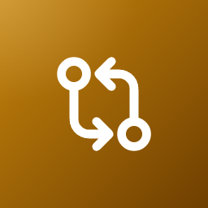
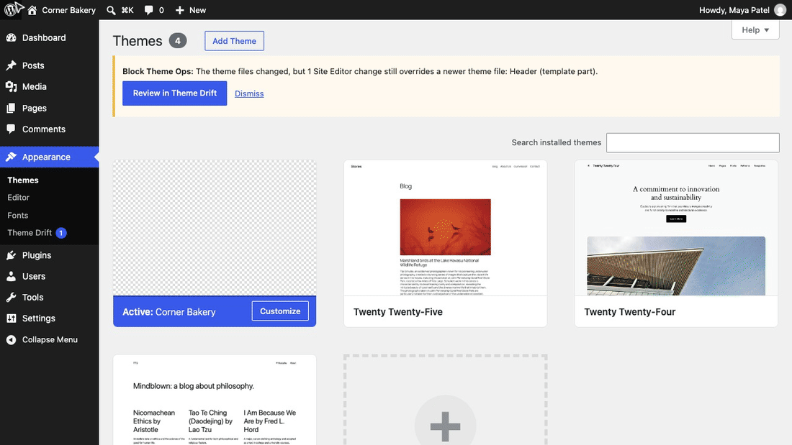
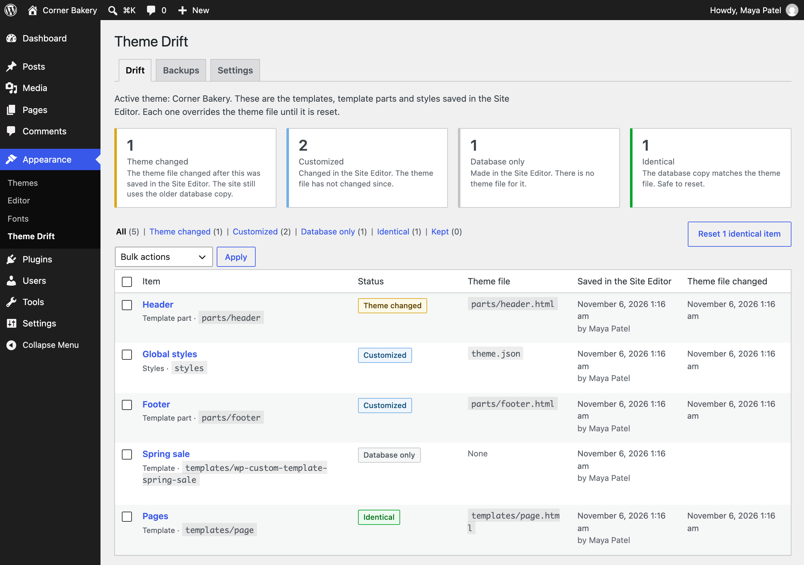
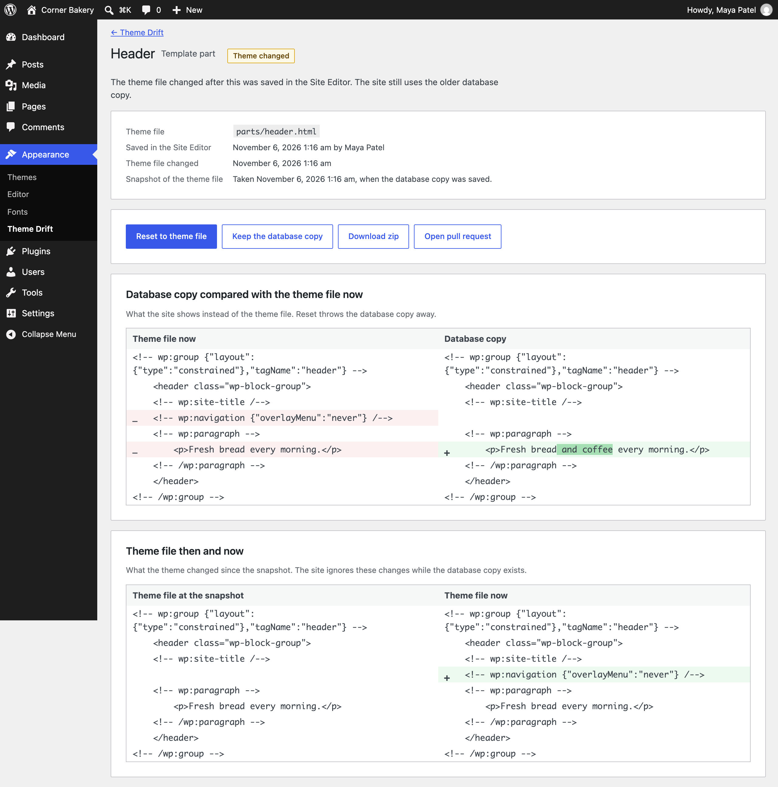
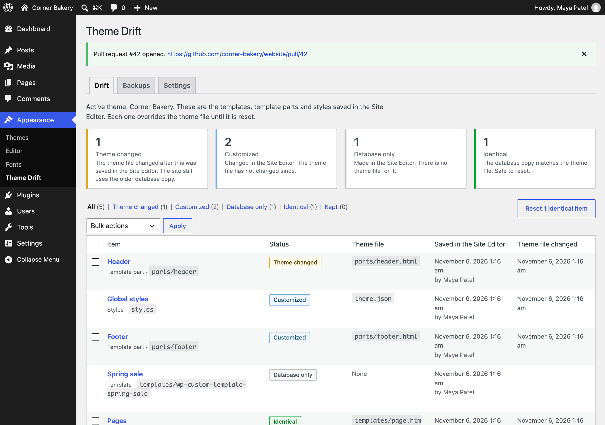
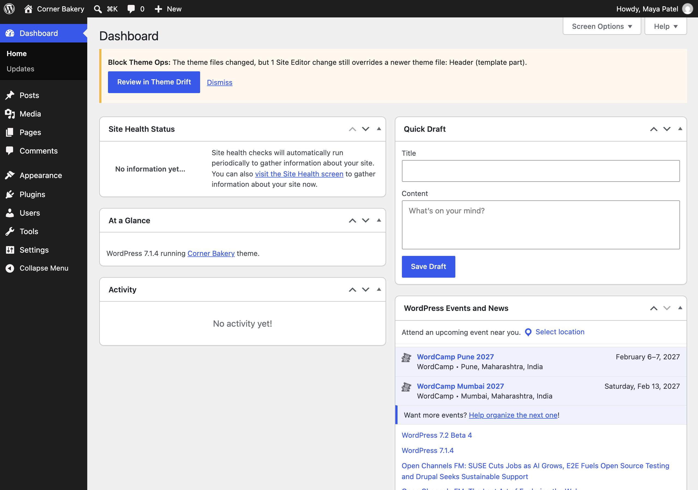
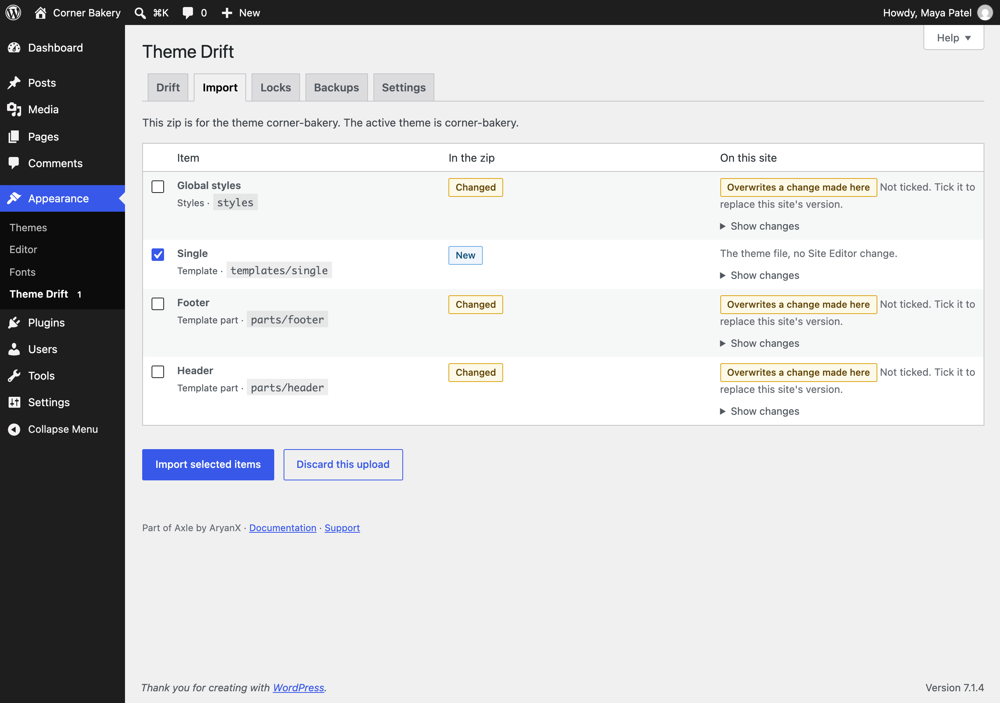
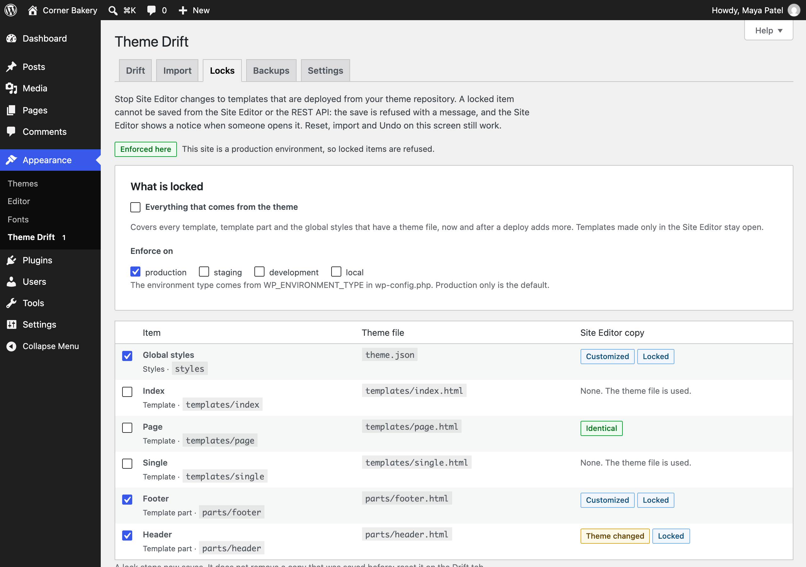

<p align="center"></p>

<h1 align="center">Block Theme Ops</h1>

<p align="center">
  <a href="https://try.axlewp.com/block-theme-ops"></a>
  <a href="https://github.com/aryanjasala/block-theme-ops/releases/latest"></a>
  
  
  <a href="LICENSE.md"></a>
  <br>
  <a href="https://github.com/aryanjasala/block-theme-ops/actions/workflows/phpcs.yml"></a>
  <a href="https://github.com/aryanjasala/block-theme-ops/actions/workflows/phpstan.yml"></a>
  <a href="https://github.com/aryanjasala/block-theme-ops/actions/workflows/unit-tests.yml"></a>
  <a href="https://github.com/aryanjasala/block-theme-ops/actions/workflows/e2e-tests.yml"></a>
  <a href="https://github.com/aryanjasala/block-theme-ops/actions/workflows/plugin-check.yml"></a>
</p>

<p align="center">Find the Site Editor changes that override your theme files, see what a theme deploy left behind, then reset them, send them to Git, import them on another site or lock them.</p>

<p align="center">
  
</p>

---

When someone edits a template, template part or the global styles in the Site Editor, WordPress saves a copy in the database and the site ignores the theme file from then on. Deploy a new version of the theme and nothing tells you the site still shows the old one. Block Theme Ops lists every one of those copies, tells you which ones now hide a newer theme file, and resets them or sends them to the theme's Git repository. It also moves the changes made on staging to production, with a preview first and one Undo, and locks the templates that belong to Git so nobody edits them in the Site Editor by mistake.

> [!NOTE]
> Free and open source under the GPL. No pro version, no upsells, no ads in wp-admin, no tracking. And it stays that way.

## Features

- **Every Site Editor change** of the active theme (and its parent): templates, template parts and global styles, with the theme file, who saved it and when
- **Drift status**: theme changed (the file changed after the edit, so the site ignores it), customized, database only, identical
- **Three-way view**: the theme file at the time of the edit, the theme file now and the database copy, as diffs
- **Reset to theme file** with a backup, and **Undo** for 30 days. **Keep** hides an item until its file changes again. Identical copies reset in bulk
- **After a theme update**, and once a day for Git or SFTP deploys: an admin notice, a Site Health check and an optional email
- **Export** a zip laid out like the theme, or open a **GitHub pull request** with the changes as one commit
- **WP-CLI** for every action, with `wp block-theme-ops check` exiting 1 for CI and deploy scripts, and **abilities** for AI agents on WordPress 6.9+
- **Import** the zip of another site (staging to production): a preview per item (new, changed, identical or for another theme), a three-way view where this site has its own change, navigation menus mapped by slug, the site address rewritten and missing media listed. One Undo for 30 days
- **Locks** stop Site Editor and REST saves of chosen templates, template parts or the global styles, on production by default, with a message that says where to change them and a notice when the Site Editor opens

## Install

1. Download `block-theme-ops.zip` from the [latest release](https://github.com/aryanjasala/block-theme-ops/releases/latest).
2. In WordPress, go to **Plugins > Add New Plugin > Upload Plugin**, choose the zip and activate it.

Or with WP-CLI:

```sh
wp plugin install https://github.com/aryanjasala/block-theme-ops/releases/latest/download/block-theme-ops.zip --activate
```

Needs WordPress 6.6+ and PHP 7.4+. To try it first, [try.axlewp.com/block-theme-ops](https://try.axlewp.com/block-theme-ops) opens a private WordPress in your browser with the latest release and some demo content. Nothing to install.

## Quick look

Stop a deploy, or fail CI, when Site Editor changes hide the new theme files:

```sh
wp block-theme-ops check || wp block-theme-ops status --status=theme-changed
wp block-theme-ops diff parts/header --against=theme
wp block-theme-ops export --pr
```

Move the changes made on staging to production, then undo if it is wrong:

```sh
wp block-theme-ops export --zip=staging.zip      # on staging
wp block-theme-ops import staging.zip --dry-run  # on production: what would change
wp block-theme-ops import staging.zip --yes
wp block-theme-ops undo 123
```

Stop Site Editor edits to templates that come from the repository:

```sh
wp block-theme-ops lock --all
```

Put the GitHub token in wp-config.php, not the database:

```php
define( 'BLOCK_THEME_OPS_GITHUB_TOKEN', 'github_pat_...' );
```

## Screenshots

<table>
  <tr>
    <td width="50%" valign="top"> Theme Drift: counts per status and every Site Editor change of the active theme"><br><sub>Appearance > Theme Drift: counts per status and every Site Editor change of the active theme</sub></td>
    <td width="50%" valign="top"><br><sub>One template part: the database copy against the theme file now, and what the theme changed since the edit</sub></td>
  </tr>
  <tr>
    <td width="50%" valign="top"><br><sub>A pull request opened on GitHub with the selected Site Editor changes</sub></td>
    <td width="50%" valign="top"><br><sub>The notice after a theme update leaves a Site Editor change behind</sub></td>
  </tr>
  <tr>
    <td width="50%" valign="top"><br><sub>The Import tab: what a zip from another site would change, item by item</sub></td>
    <td width="50%" valign="top"><br><sub>The Locks tab: which templates cannot be saved from the Site Editor</sub></td>
  </tr>
</table>

## Documentation

| Doc | What it covers |
| --- | --- |
| [Reference](docs/REFERENCE.md) | How drift is detected, reset and undo, export, import, locks, hooks, abilities, WP-CLI and stored data |
| [Development](docs/DEVELOPMENT.md) | Local setup, commands and tests |
| [Contributing](docs/CONTRIBUTING.md) | Pull requests, required checks and PR titles |
| [Releasing](docs/RELEASING.md) | How merged pull requests become releases |
| [Security](docs/SECURITY.md) | Reporting a vulnerability |
| [readme.txt](readme.txt) | What WordPress.org shows, with the FAQ and changelog |

## Project structure

```
block-theme-ops.php        plugin header and PSR-4 autoloader
uninstall.php              removes settings, locks, snapshots and backups
src/
├── Plugin.php             creates the services
├── Themes.php             finds and reads theme files, child then parent
├── Drift.php              inventory and drift status
├── Snapshots.php          snapshot of the theme file on every save
├── Markup.php             compares and pretty-prints block markup
├── StylesJson.php         the global styles layer on top of theme.json
├── Operations.php         reset, undo and keep
├── Backups.php            backups behind Undo
├── Alerts.php             items waiting for review
├── Checker.php            checks after theme updates and once a day, email
├── Exporter.php           theme files, zip with a manifest, and pull request
├── Importer.php           reads a zip, previews it, imports it, undoes it
├── Locks.php              locks against Site Editor saves
├── Git/                   Provider interface and GitHub
├── Diff.php               unified diffs for WP-CLI and abilities
├── Abilities.php          abilities for AI agents (WordPress 6.9+)
├── Privacy.php            policy text, export and erase
├── Admin/                 Appearance > Theme Drift and the admin notice
├── Health/SiteHealth.php  Site Health test
└── Cli/Command.php        wp block-theme-ops
assets/                    admin.css, admin.js, editor-lock.js
tests/
├── Unit/                  PHPUnit
└── e2e/                   Playwright specs, a small test theme and a GitHub stand-in
.wordpress-org/            screenshots, icon and banner
docs/                      reference, development, contributing, releasing
```

## More free plugins

Small plugins that each fill one gap in WordPress, all free with no pro version. Try them all together at [demo.axlewp.com](https://demo.axlewp.com/).

| | Plugin | What it does |
| --- | --- | --- |
|  | [Axle Page Template Usage](https://github.com/aryanjasala/axle-page-template-usage) | See which template every page uses, and fix the pages on a missing template |
|  | [Axle Staging Guard](https://github.com/aryanjasala/axle-staging-guard) | Stops staging copies from emailing real people, calling live APIs or getting indexed |
|  | [Axle Category & Tag Trash](https://github.com/aryanjasala/axle-category-tag-trash) | A trash for categories, tags and custom terms, with undo and full restore |
|  | [Axle Read-Only Mode](https://github.com/aryanjasala/axle-read-only-mode) | Read-only mode for WordPress during migrations and deploys |
|  | [Axle Block Restore](https://github.com/aryanjasala/axle-block-restore) | Restore a single block from an old revision, not the whole post |
|  | [Activity Log with Undo](https://github.com/aryanjasala/activity-log-with-undo) | An activity log where every change you can reverse has an Undo button |
|  | [Agent Governance](https://github.com/aryanjasala/agent-governance) | Hold risky AI agent calls for approval, preview what they change, and roll back a session |
|  | [Axle AI Guard](https://github.com/aryanjasala/axle-ai-guard) | See and control every AI call your plugins make: cost, data sent, budgets and a kill switch |
|  | [Axle Config Sync](https://github.com/aryanjasala/axle-config-sync) | Keep settings in git, diff them against the live site, apply with a preview and undo |
|  | [Axle Leftovers](https://github.com/aryanjasala/axle-leftovers) | Find what deleted plugins and themes left behind, see who owns it and why, and clean it up with undo |
|  | [Axle License Tracker](https://github.com/aryanjasala/axle-license-tracker) | See which premium plugins are licensed, which lapsed and stopped getting updates, and what renews when |
|  | [Axle Review](https://github.com/aryanjasala/axle-review) | Share drafts through private links, collect outside feedback as block Notes, and know when an approval is out of date |
|  | [Axle Runtime Doctor](https://github.com/aryanjasala/axle-runtime-doctor) | Check OPcache coverage, the object cache, PHP support and limits, cron and more, with the fix for your host |
|  | [Axle Smoke Test](https://github.com/aryanjasala/axle-smoke-test) | Check key pages after every update or deploy, see what broke and roll it back |
|  | [Block Doctor](https://github.com/aryanjasala/block-doctor) | Scan the site for broken blocks and fix them in bulk, with undo. See which posts use each block before you switch a plugin off |
|  | [Role Right-Sizer](https://github.com/aryanjasala/role-right-sizer) | Recommends the smallest role each user needs, from what they actually do |
|  | [Update Rehearsal](https://github.com/aryanjasala/update-rehearsal) | Try plugin, theme, core and PHP updates, a new plugin, or life without one, on a disposable copy of your site in WordPress Playground first |
|  | [User Session Manager](https://github.com/aryanjasala/user-session-manager) | See every device signed in, sign out one, and limit sessions per role |

## License

Copyright Aryan Jasala. Licensed under [GPL-2.0-or-later](LICENSE.md).
